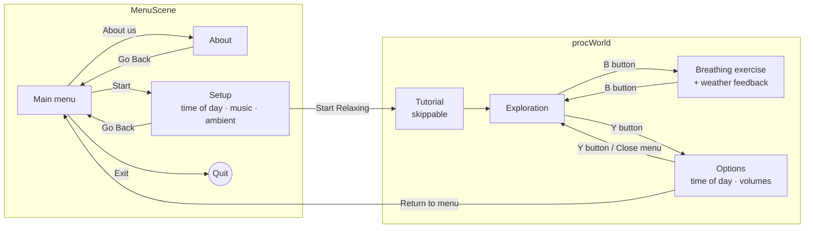

# Calm Woods

**A procedurally generated VR forest for stress management and guided breathing.**

| | |
|---|---|
| **Course** | Human Computer Interaction, Final Project (Universidad Panamericana) |
| **Platform** | Meta Quest 2 / Meta Quest 3 (standalone, Android). Tested on Meta Quest 2 |
| **Engine** | Unity 6000.5.7f1 · URP · OpenXR · XR Interaction Toolkit 3.5 |
| **Team** | Kenzo Matoo López · Jaime Rincón Burboa · José Pablo Soto Sánchez |
| **Figma prototype** | [Calm Woods on Figma](https://www.figma.com/design/DdMvp6iQemLbSBfrabTIqd/Calm-Woods?node-id=0-1&t=FtsM47eN8HwwMw0q-1) |
| **Executable (APK)** | [Download from Google Drive](https://drive.google.com/file/d/1oTDwP7lXJs1zZj0BuBfaVNGGD5zLVffb/view?usp=sharing) |
| **Commercial** | [Watch on Google Drive](https://drive.google.com/file/d/1KRVHU94-jauoJej9DZbosi9q2A0Q95-8/view?usp=sharing) |

> Calm Woods is a relaxation aid. It is **not a medical treatment**.

---

## 1. The problem

Stress is one of the most common social problems today. It affects people's health, their academic and work performance, and their overall quality of life. Many people do not have tools that are both **accessible** and **engaging** for relaxing and regulating stress in everyday life.

Virtual reality fully immerses the user in a calm environment, which reduces outside distractions and makes relaxation exercises more engaging than they are on a regular screen.

## 2. Target users

**Adults (18+) who feel stress regularly in everyday life.** Their stress is frequent but not clinical, and it comes from juggling work or study, constant deadlines and a lot of screen time. Most of them have little VR experience.

We started from a persona, **"Ana," 27**:

| | |
|---|---|
| **Goals** | Calm down quickly, feel she is "doing something that works," and not waste time |
| **Current behavior** | Scrolls her phone, listens to music or takes a walk. She tried a meditation app but dropped it because it felt boring or hard to measure |
| **Constraints** | Little time, skeptical that relaxation tools work, slightly nervous about motion sickness |
| **Needs** | Zero learning curve, visible proof that it works, and a comfortable experience |

These needs shape the solution. The weather gives *visible proof* that the user is calming down, without numbers. Defaults for time of day and volume let the user *start right away*. The session is *seated* to keep it *comfortable*.

**What the participants taught us.** The three people who tested the app (ages 19, 48 and 59: a student and two working adults) confirmed the main needs and added new ones:

- They want to **know whether they are breathing correctly**, and the meaning of the clouds was not obvious at first.
- **Music and nature sounds** matter a lot: with sound, one participant felt "much better" instead of "slightly better".
- Not everyone reads English: one participant could not follow the guide until each step was explained to them.
- They relax with music, a series or a walk, and earlier breathing or relaxation tools had not worked for two of them.
- They would come back for **short sessions** of 5 to 10 minutes.

The persona, the customer journey and these findings are in [`UserResearch.md`](Documentation/UserResearch.md).

## 3. The solution

Calm Woods places the user in a quiet natural setting and guides them through a breathing exercise. **The world reacts to how they breathe**: the more agitated the breathing, the stormier the sky; as the breathing calms down, the clouds clear. The user does not need to read numbers or charts to see their progress; the environment shows it.

### Main features

| Feature | What it does |
|---|---|
| **Procedural forest** | A new low-poly landscape is generated every session: rolling hills, mountains framing the horizon, a lake with a wooden dock, tree clusters, rocks, bushes, grass and wildflowers. A clearing is always kept free around the starting point so the user has a comfortable place to stand or sit. |
| **Guided breathing wheel** | A world-space ring split into colored arcs (inhale / hold / exhale / hold) using a **4-2-4-2** pattern (inhale 4 s, hold 2 s, exhale 4 s, hold 2 s). A marker moves around the ring, a center circle grows on inhale and shrinks on exhale, and a label and countdown say what to do. A short "GET READY" (2 s) gives the user time to get into position. |
| **Breathing detection** | The user rests the left controller on their chest; its motion gives the breathing rate and regularity. The headset microphone is used as a fallback when the controller gives no estimate. |
| **Calm score** | Breathing rate (70%) and regularity (30%) are combined into a score from 0 (agitated) to 1 (calm), and smoothed over time so the environment changes gradually. |
| **Breathing-reactive weather** | A low score brings many dark, large, low clouds circling quickly. A high score makes them lighter, smaller and farther away, leaving an almost clear sky. |
| **Tutorial** | When the forest opens, a six-step tutorial teaches walking, turning, the breathing exercise (B) and the options (Y). Each step waits for the user to do the action. Holding the trigger for 2 s skips it. |
| **Time of day** | Dawn, Afternoon, Sunset or Night, each with its own sky, lighting and mood. Can be chosen before the session and changed inside the forest. |
| **Audio** | A music playlist with crossfades, plus an ambient soundscape (day or night forest, and water that gets louder near the lake). Music and ambient volume are set independently and remembered between launches. |
| **Safe play area** | The player cannot leave the generated area or walk into the lake (except onto the dock). |

### App flow

The app has two scenes: **MenuScene** (menus) and **procWorld** (the forest).



Only one mode is active at a time in the forest: **Exploration**, **Breathing** or **Options**. Opening one menu closes the other. Menus appear in front of the user's head and fade in and out.

### Controls (Meta Quest controllers)

| Action | Input |
|---|---|
| Point at and press UI buttons / sliders | Point with the controller ray and pull the **trigger** |
| Walk / turn | **Left joystick** to walk · **right joystick** to turn |
| Open / close the breathing exercise | **B** (right controller) |
| Open / close the options menu | **Y** (left controller) |
| Breathing input | Rest the **left** controller on your chest during the exercise |
| Tutorial | Pull the **trigger** to continue a text step · **hold it 2 s** to skip the tutorial |

---

## 4. How to run the application

### Option A: install the APK on a Quest (recommended)

1. Enable **Developer Mode** on the headset (Meta Horizon app → Devices → Headset settings → Developer Mode).
2. Download the APK from [Google Drive](https://drive.google.com/file/d/1oTDwP7lXJs1zZj0BuBfaVNGGD5zLVffb/view?usp=sharing).
3. Connect the headset to the computer with a USB-C cable and accept the "Allow USB debugging" prompt inside the headset.
4. Install it with **Meta Quest Developer Hub** (drag the APK onto the device) or with ADB:
   ```bash
   adb install -r path/to/the/downloaded.apk
   ```
5. In the headset, open **Library → Unknown Sources → CalmWoods**.
6. The first time the breathing exercise is opened, the app asks for **microphone permission**. Allow it so the microphone fallback can work.

### Option B: build from the Unity project

**Requirements**

- Unity **6000.5.7f1** with the **Android Build Support** module (OpenJDK, Android SDK & NDK Tools)
- Meta Quest 2 or 3 in Developer Mode, plus a USB-C cable

**Steps**

1. Clone the repository:
   ```bash
   git clone https://github.com/JpSotoSanchez/CalmWoods.git
   ```
2. Open the project folder with Unity Hub using Unity 6000.5.7f1. The first import can take several minutes.
3. Go to **File → Build Profiles**, select **Android** and click **Switch Platform** if it is not already active.
4. Check that the **Scene List** contains, in this order and enabled:
   | Index | Scene |
   |---|---|
   | 0 | `Assets/Scenes/MenuScene.unity` |
   | 1 | `Assets/Scenes/procWorld.unity` |
5. Connect the Quest, choose it under **Run Device**, and click **Build And Run**.

### Recommended session setup

- Sit on a chair without wheels in a quiet room.
- Before starting, adjust the headset strap and the lens spacing until the image is sharp. In testing, a loose fit and wrong lens spacing were linked to blurry vision and mild dizziness.
- During the breathing exercise, rest the **left** controller flat on your chest and keep it still; if it moves more than about 5 cm, tracking restarts.
- Keep quiet while the microphone is in use, since speaking interferes with the signal.

### Known limitations

- The tutorial and the breathing guide are only in **English**.
- The tutorial explains the weather only in its last step, so first-time users may not understand the clouds right away.
- There is no **session summary** yet (start-versus-end breathing rate, time in the calm state).
- The app has only been tested on **Meta Quest 2**.

---

## 5. User testing at a glance

Three participants (ages 19, 48 and 59) tested the app on a Meta Quest 2 in a 5-minute session: 3 minutes of free exploration and 2 minutes of guided breathing. Heart rate was read with a Fitbit Inspire 3.

| Result | Value |
|---|---|
| Self-reported stress (1–10), mean of 5 app sessions | 5.0 → 4.0 |
| Heart rate, mean of 5 app sessions | 97.0 → 80.2 bpm |
| App vs. 5 minutes sitting quietly (P1) | Heart rate −17 vs. −10 bpm; "slightly better" vs. "the same" |
| Breathing guide easy to follow (1–5) | 5.0 |
| Menus easy to use (1–5) | 4.3 |
| Understood how breathing changed the weather (1–5) | 2.5, the main problem found |

Full results, findings and improvements: [`UserTesting.md`](Documentation/UserTesting.md). Protocol and raw data: [`TestingProtocol.md`](Documentation/TestingProtocol.md). These results show trends from three people, not clinical effectiveness.

---

## 6. Repository structure

```
Assets/
├── Scenes/
│   ├── MenuScene.unity          # Main menu, about and session setup
│   └── procWorld.unity          # Procedural forest + breathing experience
└── CalmWoods/
    ├── Scripts/
    │   ├── WorldGenerator.cs              # Rule-based procedural forest (terrain, lake, dock, trees, details)
    │   ├── LowPolyMeshBuilder.cs          # Low-poly mesh helpers for the generator
    │   ├── TerrainWorldGenerator.cs       # Alternative Terrain-based generator (not used in the scenes)
    │   ├── GrassInstancedRenderer.cs      # GPU-instanced grass for TerrainWorldGenerator (not used)
    │   ├── PlayerAreaLimiter.cs           # Keeps the player inside the map and out of the lake
    │   ├── TriggerModeSwitcher.cs         # Exploration / Breathing / Options modes
    │   ├── VRCanvasController.cs          # Shows world-space menus in front of the user
    │   ├── ControllerBreathingTracker.cs  # Breathing rate from a controller on the chest
    │   ├── MicrophoneBreathingTracker.cs  # Breathing rate from the headset microphone
    │   ├── CalmScoreCalculator.cs         # Rate + regularity → smoothed calm score (0..1)
    │   ├── WeatherController.cs           # Clouds driven by the calm score
    │   ├── SceneChanger.cs                # Scene loading helpers for UI buttons
    │   ├── CalmWoodsInput.inputactions    # B / Y button bindings
    │   ├── Breathing/                     # BreathingGuide (wheel UI), BreathPattern
    │   ├── TimeOfDay/                     # Presets, manager, buttons, session settings
    │   ├── Audio/                         # MusicPlaylist, AmbientSoundscape
    │   └── UI/                            # MainMenuController, TutorialGuide, Theme/ (shared UI theme)
    ├── TimeOfDay/        # Dawn, Afternoon, Sunset, Night presets
    ├── Skyboxes/         # One skybox material per time of day
    ├── Music/            # Music tracks
    ├── Sounds/           # Forest, night forest and river ambience
    └── UI/Sprites/       # Breathing wheel sprites
Documentation/        # Project documentation (see below)
```

## 7. Documentation

| File | Contents |
|---|---|
| [`DesignJustification.md`](Documentation/DesignJustification.md) | Design decisions and the HCI concepts behind them |
| [`UserResearch.md`](Documentation/UserResearch.md) | Participants, method, persona, customer journey, findings and user needs |
| [`UserTesting.md`](Documentation/UserTesting.md) | Who tested, tasks, results and improvements |
| [`TestingProtocol.md`](Documentation/TestingProtocol.md) | Test protocol, surveys, raw data and limitations |
| [`AIUsage.md`](Documentation/AIUsage.md) | AI tools used, what for, and how output was checked |

## 8. Credits

- **Team:** Kenzo Matoo López, Jaime Rincón Burboa, José Pablo Soto Sánchez
- **Instructors:** Dr. Jafet Rodríguez, Ing. Renata Aparicio
- Unity **VR Template** (XR Origin setup) and **XR Interaction Toolkit**
- **Inter** font
- **BOXOPHOBIC**: Skybox Cubemap Extended
- Music and ambient sounds: TODO: sources and licenses
